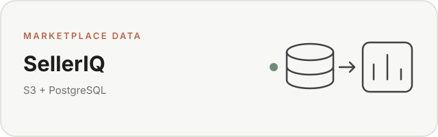

# SellerIQ

<picture>
  <source media="(prefers-color-scheme: dark)" srcset="assets/readme-card-dark.svg">
  <source media="(prefers-color-scheme: light)" srcset="assets/readme-card-light.svg">
  
</picture>

**SellerIQ is an analytics engineering project that turns Amazon SP-API data into a reusable warehouse for marketplace reporting and downstream applications.**

The public `stable-weekly` implementation ingests Amazon sales, traffic, catalog, listings, and FBA inventory data; preserves raw responses in Amazon S3; transforms source data with Python and SQL; and loads modeled PostgreSQL tables for analysis and dashboards.

This repository contains the ingestion and warehouse layer. The dashboard lives in [selleriq-app](https://github.com/dillonleeper/selleriq-app).

## What this project demonstrates

- **API ingestion:** authenticated extraction from Amazon SP-API reports and catalog endpoints
- **ELT / ETL design:** raw retention, staging, transformation, and modeled warehouse tables
- **Python data engineering:** ingestion jobs, parsing, validation, retries, backfills, and orchestration
- **SQL data modeling:** staging, intermediate, fact, dimension, and identity-mapping tables
- **Cloud storage:** raw API responses archived to Amazon S3 for reprocessing and auditability
- **PostgreSQL / Supabase:** structured analytical storage queried by a separate application layer
- **Data quality and reliability:** checksums, ingestion status logging, idempotent/upsert patterns, and rerun logic
- **Multi-marketplace modeling:** US and Canada data modeled with explicit marketplace grain

## Architecture

```text
Amazon SP-API
      |
      v
Reports + Catalog endpoints
      |
      v
Python ingestion jobs
      |
      +----> Amazon S3 raw archive
      |
      v
PostgreSQL staging tables (stg_*)
      |
      v
Intermediate models (int_*)
      |
      v
Fact + dimension tables (fct_*, dim_*)
      |
      v
SellerIQ dashboard / downstream analysis
```

The pipeline follows a layered approach: preserve source data first, load source-shaped staging tables, resolve product identity, then expose modeled facts and dimensions to downstream consumers.

## Implemented data sources

| Source | Method | Output |
| --- | --- | --- |
| Sales & Traffic | Amazon Reports API | Weekly ASIN-level sales, sessions, page views, Buy Box %, conversion |
| Catalog Items | Amazon Catalog Items API | Titles, brands, identifiers, parent/child relationships |
| Listings | Amazon Reports API | Seller SKU-to-ASIN mappings |
| FBA Inventory | Amazon Reports API | Daily fulfillable, reserved, inbound, and available quantities |

Planned sources such as Amazon Finance, Advertising, Orders, Walmart Marketplace, and Walmart Advertising are **not** implemented on this public branch.

## Warehouse model

### Sales and traffic

| Table | Grain | Purpose |
| --- | --- | --- |
| `stg_amz_sales_traffic_daily` | report ID + child ASIN + marketplace | Source-shaped Sales & Traffic rows |
| `fct_sales_daily` | period + child ASIN + marketplace | Modeled sales and traffic fact table |
| `ingestion_job_log` | one row per ingestion job | Pipeline status, row counts, file metadata, and errors |

### Product identity

| Table | Grain | Purpose |
| --- | --- | --- |
| `stg_amz_catalog_items` | ASIN + marketplace | Catalog metadata |
| `stg_amz_listings` | SKU + marketplace | Seller SKU-to-ASIN mapping |
| `dim_product` | product / marketplace | Product dimension with SKU, ASIN, title, and brand |
| `int_product_identity_map` | child ASIN + marketplace | Bridge between sales rows and product identity |

### Inventory

| Table | Grain | Purpose |
| --- | --- | --- |
| `stg_amz_inventory_snapshot` | snapshot date + SKU + marketplace | Source-shaped FBA inventory snapshot |
| `fct_inventory_snapshot_daily` | snapshot date + SKU + marketplace | Modeled inventory fact joined to product identity |

## Pipeline entry points

| Script | Purpose |
| --- | --- |
| `ingest_sales_traffic.py` | Ingest the last complete week of Sales & Traffic data |
| `backfill_sales_traffic.py` | Backfill historical Sales & Traffic data from January 2025 forward |
| `ingest_catalog.py` | Ingest catalog metadata and refresh product identity |
| `ingest_listings.py` | Ingest seller listings and SKU mappings |
| `ingest_inventory.py` | Ingest a daily FBA inventory snapshot |
| `run_weekly_update.py` | Orchestrate the recurring weekly pipeline |
| `reload_sales_from_s3.py` | Reparse archived raw sales files and reload them into PostgreSQL |
| `verify_s3_raw.py` | Verify raw S3 artifacts |

## Pipeline behavior

### Raw retention

Raw report and catalog responses are saved to S3 before or alongside structured loading so source data can be inspected and reprocessed later. The repository does not configure S3 Object Lock or bucket versioning; archive immutability depends on external bucket configuration.

### Transformations

Python handles API interaction, parsing, source-level validation, and loading. SQL defines warehouse structures and shared analytical models. S3 is storage only; it does not perform transformations.

### Reliability and reruns

The code includes:

- retry handling around SP-API calls
- ingestion-job status logging
- row counts and file checksums where supplied
- upsert / conflict-handling patterns
- historical backfill support
- S3-based reload workflows
- per-step logging and failure summaries in the weekly orchestrator

The public implementation is intentionally explicit about limitations. Conflict keys and logging coverage differ by ingestion path, and some maintenance scripts assume schema changes beyond the checked-in DDL. Review rerun behavior before using it in production.

## Tech stack

| Layer | Technology |
| --- | --- |
| Language | Python |
| API | Amazon Selling Partner API |
| Raw storage | Amazon S3 |
| Analytical database | PostgreSQL / Supabase |
| Data modeling | SQL |
| API SDK | `python-amazon-sp-api` |
| Database driver | `psycopg2` |
| AWS client | `boto3` |
| Version control | Git / GitHub |

## Setup

### Prerequisites

- Python 3.11+
- PostgreSQL database
- AWS account and S3 bucket
- Amazon SP-API developer application and refresh token

### Install dependencies

```bash
pip install python-amazon-sp-api boto3 psycopg2-binary
```

### Configure credentials

Create a local `config.py`. It is ignored by Git; do not commit credentials.

```python
AMAZON_CLIENT_ID = "your_client_id"
AMAZON_CLIENT_SECRET = "your_client_secret"
AMAZON_REFRESH_TOKEN = "your_refresh_token"

AWS_ACCESS_KEY_ID = "your_access_key"
AWS_SECRET_ACCESS_KEY = "your_secret_key"
AWS_REGION = "us-east-1"
S3_BUCKET = "your-bucket-name"

POSTGRES_HOST = "your_host"
POSTGRES_PORT = 5432
POSTGRES_DB = "postgres"
POSTGRES_USER = "postgres"
POSTGRES_PASSWORD = "your_password"

US_MARKETPLACE_ID = "ATVPDKIKX0DER"
CA_MARKETPLACE_ID = "A2EUQ1WTGCTBG2"
SELLER_ID = "your_seller_id"

REPORT_POLL_MAX_ATTEMPTS = 30
REPORT_POLL_SLEEP_SECONDS = 30
DRY_RUN = False
ENVIRONMENT = "dev"
RAW_OUTPUT_DIR = "raw_reports"
```

### Create warehouse tables

Run the checked-in DDL in order:

```sql
\i sql/selleriq_phase1_ddl.sql
\i sql/selleriq_phase2_ddl.sql
\i sql/selleriq_phase3_ddl.sql
```

### Run ingestion

```bash
python ingest_sales_traffic.py
python backfill_sales_traffic.py
python ingest_catalog.py
python ingest_listings.py
python ingest_inventory.py
```

For the recurring pipeline:

```bash
python run_weekly_update.py
```

## Project scope

This repository is a public, sanitized implementation of the data-engineering layer rather than a hosted SaaS product. It requires your own Amazon credentials, S3 bucket, and PostgreSQL database, and it does not include marketplace data.

The project grew out of an earlier [DIY Amazon Sales & Traffic Pipeline](https://github.com/dillonleeper/amazon-sp-api-sales-pipeline) that loaded a smaller reporting dataset into Google Sheets. SellerIQ moves the analytical workload into a layered warehouse so data can be preserved, reprocessed, modeled once, and consumed by multiple views.

## Related repositories

- [selleriq-app](https://github.com/dillonleeper/selleriq-app) — dashboard / application layer
- [selleriq-site](https://github.com/dillonleeper/selleriq-site) — public website
- [amazon-sp-api-sales-pipeline](https://github.com/dillonleeper/amazon-sp-api-sales-pipeline) — earlier Google Sheets pipeline

## License

The repository is public, but no license for external use is granted.
